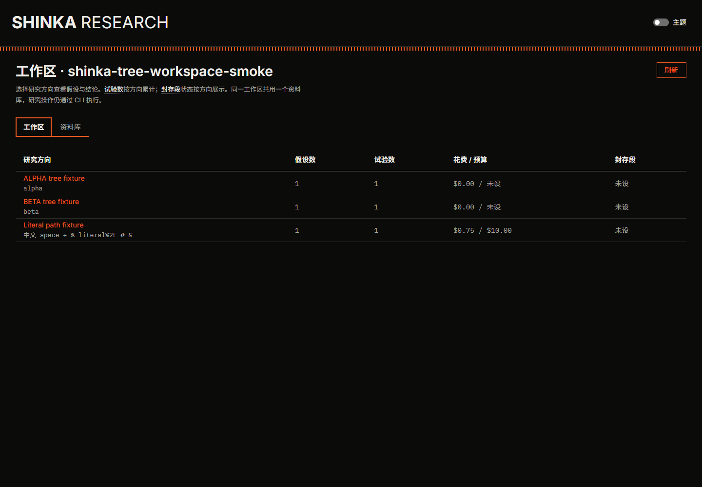
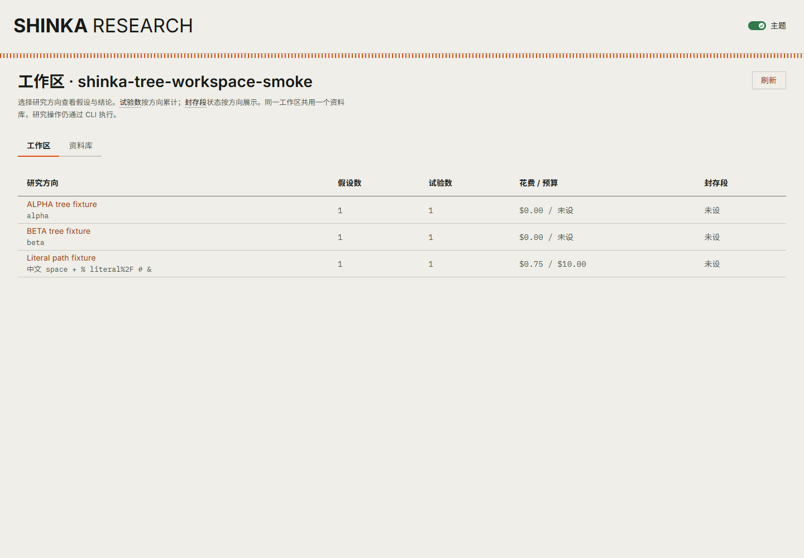
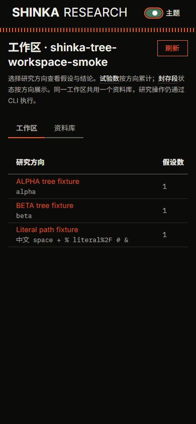

# 工作区页技术验收

工作项：[GitHub #12](https://github.com/2233admin/ShinkaEvolve/issues/12)。本文记录实现者的技术验收，不代表所有者视觉验收，也不补签原设计流程的验收状态。

## 版本与范围

- 功能分支：`research/workspace-page`；最终回归基于 `aec61a16eca7d89170d018d127312b42fc9cb104` 加本 PR 的工作区变更。
- SQLite 上游前置修复已通过独立 [PR #14](https://github.com/2233admin/ShinkaEvolve/pull/14) 合并。工作区 PR 不包含该修复的上游核心 diff。
- 本项只增加工作区入口、方向导航和必要的读取隔离。现有假设正文、图表、时间线、结论台账与共享资料库继续复用。
- 所有截图和数据库都是明确标识的合成夹具，不是 au-5090 真实研究，也不作为第 2 项的完成证据。

## 安装与构建

本机使用 Python 3.12、pnpm 11.25.0。原锁文件的两个过新版本被安装器的发布时间策略拒绝；锁文件仅将 Rollup 及其匹配的原生包从 `4.64.8` 调整为 `4.64.7`，将 `electron-to-chromium` 从 `1.5.459` 调整为 `1.5.458`，没有关闭供应链校验或改变直接依赖。

本轮安装明确选择不执行依赖生命周期脚本，实际命令为 `pnpm install --frozen-lockfile --ignore-scripts`。该选择不是新增的全局安装策略。Windows 大小写冲突通过把辅助模块 `markdown.ts` 更名为 `renderMarkdown.ts` 并迁移唯一调用方解决。

`pnpm build --logLevel warn` 成功。Vite 仍报告既有的大于 500 kB 的 chunk 警告；本项没有关闭该警告或修改构建阈值。

## 最终回归

| 环境与命令 | 实际结果 |
| --- | --- |
| Windows：`uv run ruff check shinka/research tests/research` | 通过 |
| Windows：`uv run ruff format --check shinka/research tests/research` | 24 个文件符合格式 |
| Windows：`uv run pytest -q tests/research` | 71 passed，39.58 秒；真实 junction 用例执行成功 |
| Linux：`python -m ruff check shinka/research tests/research` | 通过 |
| Linux：`python -m ruff format --check shinka/research tests/research` | 24 个文件符合格式 |
| Linux：`python -m pytest -q tests/research` | 70 passed，1 skipped，36.74 秒 |
| Linux：`python -m pytest -q -m 'not requires_secrets'` | 980 passed，1 skipped，1 deselected，76.19 秒 |

Linux 使用 WSL `archlinux` 的既有隔离虚拟环境 `/tmp/shinka-issue12-linux-env`，Python 3.12.15、Ruff 0.15.6、Node 24.21.0。导入探针确认 `shinka`、`research.ui`、`research.rundb` 都来自本功能 checkout，不是已安装的旧 wheel。验证期间源码被只读挂载，缓存和临时文件放在仓库外；验证者没有修改源码或排除额外测试。

唯一 skip 是仅适用于 Windows 的 junction 用例；该用例已在 Windows 的 71 项测试中通过。全套测试的 5 条警告来自既有 `shinka/llm/prioritization.py:1343` 的 bandit 数值计算。最终 Linux 证据位于：

```text
\\wsl.localhost\archlinux\tmp\shinka-workspace-final-acceptance\run-20261017T205148Z-cebcc1b160\
```

该目录保留命令、完整标准输出/错误、JUnit、导入路径、前后文件指纹及进程清理记录。总封装器因截图 `dark.png` 在采集期间更新而返回 1；四个门禁进程均返回 0。独立比较确认 331 个代码/测试/配置文件的指纹不变，唯一并发变化是截图，不能将封装器返回值隐去或称为全绿。

### 先失败、后通过的回归

- 工作区入口和相同实验相对路径串方向：旧实现下 13 项失败；修复后通过。
- 资料库根、wiki/raw、假设正文、事件、实验根与数据库叶子越界，以及真实特殊目录数据库：旧实现下 8 项失败；修复后通过。
- 树服务隐式读取的提示库、meta、失败 JSON 和生成代码：实际 HTTP 复现了外部内容返回；修复后拒绝读取。
- 非对象库清单、Windows 同级 junction、失败 JSON 指回内部但外部父目录被枚举：4 failed、1 passed；修复后两个读取边界测试文件合计 17 passed。

## 真实浏览器与服务冒烟

最终服务通过实际 CLI 启动：`uv run shinka_research ui <workspace> --port 8767 --no-browser`。Chrome 由 Playwright 驱动，页面不是静态 HTML 截图。

| 路径 | 观测证据 |
| --- | --- |
| 工作区列表 | 显示 alpha、beta、特殊目录三个方向，假设数、试验数、预算与封存状态来自实际 Notebook/SQLite |
| root → A → root → B | A 返回 `alpha-smoke-program`，B 返回 `beta-smoke-program`；两个树服务端口不同，共用相同 `h001/e01/results/programs.sqlite` 相对路径仍不串数据 |
| 浏览器后退与重载 | 返回 B 后重载，标题仍为 `BETA tree fixture` |
| 中文、空格、`+`、`%`、字面 `%2F`、`#`、`&` | 点击真实目录链接后正确打开该方向，花费为 $0.75，最佳样本内分数为 3.75 |
| 特殊目录的实际进化树 | 从“看进化树”打开页面，HTTP 200；程序 ID 为 `literal-smoke-program`，提示 ID 为 `literal-smoke-prompt`，响应不含私有标记，`private_metrics_hidden=true` |
| 共享资料库 | 工作区资料库页签显示实际 `Library index` 正文；既有 HTTP 用例同时验证方向页使用同一份库 |
| 键盘导航 | 方向链接获得焦点后按 Enter，进入对应方向；主题开关可通过 Space 切换 |
| 深浅主题 | 亮色模式重载后仍保留；两种主题均重新截图 |
| 390 px 窄屏 | 页面宽度 390 px，表格宽度 720 px；横向滚动后最后一列表头位于 x=288.91、宽 85.09，未造成整页横向溢出 |
| 前端运行错误 | 最终页面的 `pageerror` 记录为空 |

第一轮实际浏览器验证还覆盖了空工作区、损坏条目不可进入、未知深链接返回后的恢复、迟到方向请求不覆盖新方向，以及刷新。最终服务及它拥有的三个树服务已正常停止；对四个端口重新请求均得到 `ECONNREFUSED`，本轮专用 Chrome 也已关闭。验收没有留下后台交付服务。

## 截图

截图对应最终构建与合成夹具；截图内的英文方向标题是夹具名称，不是新增 UI 英文文案。

### 暗色桌面



### 亮色桌面



### 窄屏



## 辅助结构诊断

仓库没有提交 Sentrux 规则或基线；`code-intel sentrux check` 明确显示 `Quality: not gated` 和缺少活动基线。本轮原始观察基线完整保留在 `structural-baseline.json`，没有被新结果覆盖。

| Sentrux 2.2.0 指标 | 原始观察 | 最终观察 |
| --- | ---: | ---: |
| quality_signal | 9569 | 9418 |
| coupling_score | 53.79 | 54.00 |
| cycle_count | 0 | 0 |
| complex_fn_count | 0 | 0 |
| god_file_count | 0 | 1 |
| max_complexity / 文件词法分支密度 | 11 | 18 |

最终观察来自 `code-intel sentrux scan shinka/research`。这项辅助诊断没有达到原始观察值，本项不把它报告为通过。旧引擎把文件词法分支数除以其识别出的函数行数；它未识别 `export default function App` 和嵌套 async 函数，不能把 `max_complexity=18` 当成某个函数的圈复杂度。实现没有为了改变该分母而增加包装函数、重置基线或放宽规则。

唯一的规模标签对应 `ui.py`：483 行物理源码、434 行非空内容、24 个 Python 函数和 2 个类。旧引擎把类声明也计入“函数”，其条件 `lines > 800 || (functions > 25 && lines > 400)` 因 26 个词法声明而触发。该标签是固定的规模阈值，不是新增循环或复杂函数的证据；本项保留现有 UI 模块边界，没有仅为跨过阈值而搬移函数。规则出处是工具仓 `d913f26a` 的 `sentrux_gate.rs:91–93,895–897,912–940`。

## 验收边界

- 技术验证不等于所有者视觉验收；所有者尚未对新增工作区页作最终确认。
- 第 2 项真实研究、第 3–5 项组件与图表改进、第 6 项原流程验收补记仍是独立工作。
- 第 7 项只在发布 PyPI 包时触发；第 8 项必须先提交领域接口设计并获得确认。
