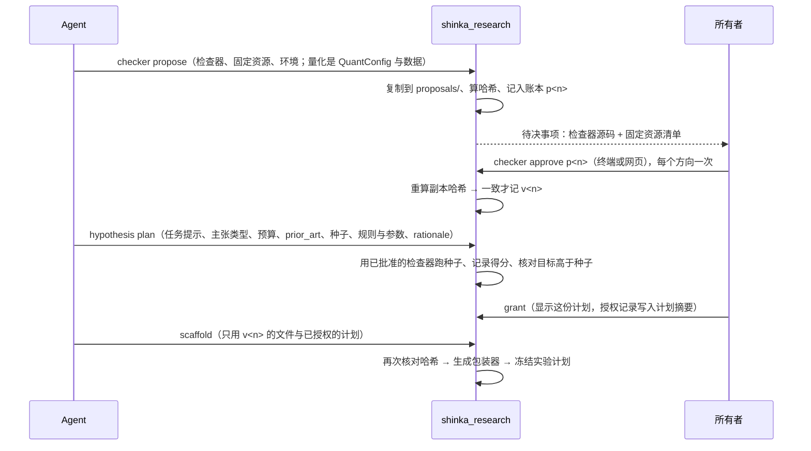

# Design：通用研究领域

## 分层

| 层 | 管什么 | 由谁定 |
|---|---|---|
| 核心 | 方向、假设、实验计划、候选的隔离执行、运行、证据、结论台账、试验计数、预算、批准账本、来源记录（谁加入了哪个资料，见“许愿与联网”）、**判定规则**、工作台 | 框架，所有领域相同，随仓库版本化 |
| 领域预设 | 数据怎么准备（量化：切封存段）、`program.md` 与任务提示模板、工作台用词、默认判定规则、声明的能力 | 可选；新领域可以没有预设 |
| 实验 | 检查器（评估器）、数据、选用哪条判定规则与阈值、任务提示 | Agent 起草，所有者批准后冻结（决定 A） |

**判定归核心，不归领域。** 判定规则是核心里一组封闭、带版本的规则种类；领域与 Agent 只能选用并给阈值，不能写新的判定代码。领域相关的一切判断写进检查器，检查器经所有者批准并冻结哈希。这样 Agent 进入一个新领域时，不需要先有人写一个 Python 插件；只有当现有规则种类表达不了时，才在仓库里加一条新规则（一次正常的代码审查）。

**搜索目标与结论证据分开。** 搜索目标沿用 ShinkaEvolve 的契约：每个候选必须得到一个确定的数值 `combined_score` 和 `correct` 标记，进化靠它挑选，本变更不改上游引擎。结论证据由质疑检验产生，可以是多个指标、阈值、重复实验或通过与否的检查，判定只看证据与冻结的规则。

**核心不再假定**数据可切分、需要多重检验校正或有封存段；这些是领域声明的能力。核心只要求：实验作为程序反复执行，检查器与数据有哈希，判定规则在实验开始前写定。

## 方向的领域

`shinka_research init <dir> --domain <name>` 写定方向的领域，之后不能改；方向里每个实验的计划必须与它一致。试验数、方差估计与封存段都是方向级的，混入别的领域会把不同量纲混算（`skeptic.py:184-207`）。`--domain` 缺省为 `quant`，现有方向读取时视为 `quant`。没有预设的领域写 `--domain open`，由 Agent 起草全部内容。`program.md` 模板按领域生成，`open` 的模板只列方向、约束、预算与审批规则，不含 K 线与 Sharpe。

## 实验计划

批准后冻结、写进笔记本的一条记录，作为实验记录的**新增可选字段**；旧字段 `evaluator_hash`、`data_path`、`data_hash` 保留不动（8 个测试文件直接构造它们）。

```json
{
  "domain": "open",
  "harness": "subprocess-artifact/1",
  "checker": {"files": {"check.py": "sha256:…"}},
  "data": {"files": {"data/instances.json": "sha256:…"}},
  "task_message": "sha256:…",
  "rule": {"kind": "reach_target", "version": 1, "thresholds": {"target": "<目标值>"}, "on_budget_exhausted": "refuted"},
  "rationale": "<与所有者对话时约定的推翻标准原文，只作审计，不参与判定>",
  "seed": {"correct": true, "score": 0.96},
  "prior_art": {"status": "found", "best": "<数值>", "source": "<raw/ 中的资料>", "searched": ["<检索词>"], "direction": "higher_is_better", "tolerance": "<绝对容差>"},
  "claim": "certificate",
  "environment": {"python": "3.12", "lock": "sha256:…"},
  "budget": {"usd": 5, "generations": 50},
  "proposal": "p004", "approval": "v004", "grant": "g012"
}
```

- `verify_experiment` 按计划逐个文件校验，包括生成的包装器 `evaluate.py`；任何一个哈希变了，`run`、`probe`、`skeptic`、`verdict` 都拒绝，并指出是哪个文件。
- 判定规则与阈值随计划冻结，有计划的实验不接受命令行阈值。
- **旧实验不补计划。** 没有计划的实验标为“未冻结（旧）”，继续按现在的方式接受命令行阈值（`program.md` 的阈值由 Agent 传入，`SKILL.md:194`），工作台标明。这样已有结论与 `tests/research` 的行为不变；只有新加的测试覆盖“有计划时拒绝命令行阈值”。
- **所有者认可的是整份计划**，不只是检查器，分两步：检查器、数据文件与运行环境（Python 版本与依赖锁文件的哈希）在方向批准时冻结；任务提示、判定规则与阈值、主张类型（`certificate` 证书型：产物本身是可完整验证的证明，可以没有留存段；`empirical` 经验型：必须带隐藏实例或留存数据与最终评估）、预算、`prior_art` 与种子得分在授权该假设的轮次时冻结（见“检查器提案与批准”）。之后改其中任何一项，都是新实验、要重新批准或授权。
- **外部已知结果随计划冻结（防茧房的主杠杆）：** 计划带 `prior_art`，状态三选一：`found`（外部已知的最好结果、来源、检索词）、`none_found`（检索过、列出检索词、没找到）、`unavailable`（没有联网条件，未检索；不得伪装成 `none_found`）。所有者授权轮次时与检查器、目标值放在同一屏看到。`found` 时同时冻结比较方向（`higher_is_better` 或 `lower_is_better`）与绝对容差：外部来源的精度各不相同，仓库里就同时有提示词写的 2.635（`examples/circle_packing/run_evo.py:10`）和示例输出 2.6359828…（`viz_circles.ipynb`），不按容差比较，同一产物会因来源精度不同被标成不同档位。`reach_target` 的结论与报告写明落在哪一档：差于已知超过容差、在容差内（复现已知）、优于已知超过容差；`unavailable` 与 `none_found` 时写“没有外部参照”。`holdout_vs_baseline` 有外部方法时，基线取引用到的最强外部方法，不能只比买入持有这类弱基线（`cli.py:99`）。这样联网得到的知识直接改变结论的措辞，并随计划冻结、不能事后改；目标值也不再只拿 Agent 自己写的种子程序来比（`reach_target` 的目标必须高于种子得分，见判定规则）。
- **已知答案测试（有就附上）：** 方向提案或假设计划中如果存在外部已知的正确产物或错误产物，检查器必须认可前者、拒绝后者，结果给所有者看。不是每个领域都有已知答案，所以不强制。

## 候选的隔离执行（核心提供）

Agent 起草的只是检查器，不是完整的评估器。核心生成评估器包装器，做法与量化的 `EVALUATE_TEMPLATE` 相同：Shinka 只读取 `evaluate.py` 的文本、复制到结果目录再运行（`shinka/cli/run.py:491`、`shinka/core/async_runner.py:361-364`），所以包装器内嵌已批准提案与数据清单的绝对路径。

1. 包装器在独立的 `python -I` 子进程里运行候选程序（做法同量化的 `run_view`、`shinka.research.child`，`quant.py:202-226`），约定候选把结果写成一个产物文件（JSON 或 `.npz`）。
2. 候选进程退出后，另一个进程加载冻结的检查器，只读这个产物，返回 `correct`、`combined_score` 与 public / private 指标，写成 Shinka 期望的 `metrics.json` / `correct.json`。
3. 检查器从不导入候选代码，得分由检查器从产物算出，不信任候选自报的数值。

这样排除了圆填充现有评估器的两个问题：候选与校验在同一进程，可以替换校验函数（`shinka/core/wrap_eval.py:29-36`）；得分取候选自报的半径和，默认相对误差 1e-5（`examples/circle_packing/evaluate.py`）。

**这不是操作系统沙箱。** `python -I` 只让 Python 忽略环境变量与用户 site-packages，不限制文件、网络与子进程。候选仍能按绝对路径读写检查器与数据、联网、起别的进程。本版能如实保证的是：

- **证书型主张有条件地可信。** 候选可以起不随父进程退出的子进程，在确认阶段继续改检查器或产物（哈希校验之后、打开文件之前），恶意产物也可能攻击解析器。所以确认必须：先终止候选的整个进程树（Windows 上用 Job Object 包住候选，退出时连同子进程一起结束）；把检查器与产物复制进以哈希命名的只读目录，核对哈希后只从这份副本加载；产物只用不执行代码的格式解析（JSON，或 `numpy.load(allow_pickle=False)`）；确认在新的进程里运行，不运行候选代码。四条都做到，证书型结论才可信；任何一条做不到，结论同样标“未沙箱”。
- **经验型主张靠约定。** 候选能读到隐藏实例或留存数据，也能联网查到答案；这与量化封存段今天的处境相同（`prepare_data` 只写出 `dev.csv`，原始 CSV 仍在磁盘上，`scaffold.py:78-93`）。工作台在这类结论旁标“未沙箱”。
- **研究 Agent 联网与候选联网是两回事。** 研究 Agent 可以联网检索（见“许愿与联网”）；候选执行应当断网、只挂载输入与一个可写产物目录、检查器与隐藏数据在候选退出后才挂载。这需要真正的沙箱（WSL 中的 bubblewrap、`docker --network none` 或 Windows AppContainer）。所有者 2026-10-22 定为以后再做，本版如实标“未沙箱”。

**确认**改为只用冻结的检查器重新校验保存下来的产物，不重跑候选程序。对确定性的检查，这比重跑更强，也不受程序是否随机影响。

## 判定规则（核心，封闭集合）

| 种类 | 证据 | 成立 | 推翻 | 证据不足 |
|---|---|---|---|---|
| `dsr_pbo`（量化现行） | 样本外 Sharpe、DSR、子区间、PBO，试验校正 | 现行 `skeptic.decide` | 现行 | 现行 |
| `reach_target` | 检查器认可的最好产物的得分 | 达到冻结的目标值 | `on_budget_exhausted = refuted` 且预算用完仍未达到（推翻的是“这个方法在这个预算内能达到”） | 尚未达到；或 `on_budget_exhausted = insufficient` 且预算用完仍未达到 |
| `counterexample` | 检查器认可的反例产物 | — | 找到合法反例 | 没找到 |
| `holdout_vs_baseline` | 留存段上的指标与冻结基线的差（越大越好）：原始差值，以及按试验数校正后的差值（领域声明 `trial_correction` 时由随检查器冻结的校正给出，否则等于原始差值；不得大于原始差值） | 校正后的差值大于阈值 `support_margin` | 原始差值不大于 0（试验多不会让推翻更容易，同 `dsr_pbo` 只按样本外 Sharpe 不大于 0 推翻） | 介于两者之间 |

- 规则带版本，计划记录种类与版本；改规则的行为就是新版本，旧计划继续用旧版本。
- `reach_target` 的目标值在 `hypothesis plan` 时校验：用方向已批准的检查器跑一次种子程序，记录 `correct` 与得分，目标必须高于种子得分，否则拒绝该计划。
- **推翻标准在与所有者对话时定下（所有者 2026-10-22：「实际上跟用户对话的时候就证伪了」）：** 可证伪性不在研究结束后补，而在许愿后、所有者授权该假设的轮次前的对话里定。对话定下的是可执行的标准，落在规则的种类与参数上：选哪种规则、阈值多少，`reach_target` 还要选 `on_budget_exhausted`（`refuted`：预算用完仍未达到就判推翻；`insufficient`：只判证据不足）。其他规则的推翻条件由核心固定（`counterexample`：检查器认可的反例；`holdout_vs_baseline`：差值不大于 0；`dsr_pbo`：量化现行规则），不另设。对话原文存进实验计划的 `rationale` 只作审计，判定只看规则种类与参数，所以不会出现两套判定来源。判词由实验结果触发，对话只定标准。
- 改判：Agent 执行环境中 `verdict --label` 不能把结论往“成立”方向改；改判只由所有者执行（现在 `cli.py:726-728` 不限制，`SKILL.md:194` 还允许 Agent 改判）。

## 检查器提案与批准（决定 A，按方向批准）

所有者 2026-10-22 定：检查器一个方向批准一次。方向内的试验数与方差按同一个检查器才有意义（`skeptic.py:184-207`），也省所有者的时间。批准分两层：

| 层 | 内容 | 由谁、何时认可 |
|---|---|---|
| 方向批准（`v<n>`） | 可复用的检查器及其固定资源（检查器离不开的常量表、模式文件等）、运行环境；量化方向是 `QuantConfig` 与数据（封存段切分本来就是方向级，`notebook.py:93-116`） | 所有者 `checker approve`，每个方向一次；换检查器就是新提案、新批准 |
| 假设的实验计划 | 任务提示、主张类型、预算、这个假设自己的数据文件、隐藏实例或留存数据（经验型必带其一，并带最终评估）、`prior_art`、种子程序与检查器测得的种子得分、规则种类与阈值、`reach_target` 的 `on_budget_exhausted`、对话原文 `rationale` | 许愿后的对话里约定；所有者授权该假设的轮次（`g<n>`）时，授权记录写入这份计划（含数据文件哈希）的摘要，计划随之冻结 |

这样同一方向里的不同假设可以有不同的主张类型、预算、数据与外部参照，共用的只是检查器与它的固定资源（量化还共用数据切分）。



- **方向提案：** `shinka_research checker propose <dir> --checker <file> [--resource <file>…]`（量化方向为 `--quant-config <file> --data <file>`）。文件复制进 `<dir>/proposals/<pid>/`。
- **假设的实验计划：** `shinka_research hypothesis plan <dir> <hid> --initial <file> --task <file> --claim certificate|empirical --budget-usd <usd> [--data <file>…] [--hidden <file>…] --prior-art <file> --rule <kind> [--threshold k=v…] [--on-budget-exhausted refuted|insufficient] --rationale <file>`。数据与隐藏实例复制进计划目录并记哈希（量化方向不另带数据，用方向的切分）。命令用方向已批准的检查器跑一次种子程序、记录得分（不信任 Agent 自报），`reach_target` 的目标必须高于这个得分；计划写进待授权状态，`grant` 列出它的全文。
- **账本：** 提案与批准是 `ledger.json` 里新的两种记录（编号前缀 `p`、`v`），与轮次授权（`g`）、封存段批准（`a`）分开；封存段只认 `a` 编号，检查器批准不能拿去开封存段。轮次授权新增每个假设实验计划的摘要字段。账本校验（`grants.verify`，现在遇到未知种类即拒绝，`grants.py:233-234`）加入这两种，并与运行日志里的事件对照；日志写入提案文件的摘要，与轮次授权的 `_digest` 做法相同（`grants.py:97-100`），账本被改会被发现。
- **批准：** `shinka_research checker approve <dir> <pid>`。带 `SHINKA_RESEARCH_AGENT` 标记的环境中拒绝；网页走 research-agent 的 Agent 服务的所有者通道。批准时与工作台展示前都重算 `proposals/` 副本的哈希，与提案记录不符就拒绝，因为方向目录 Agent 可写。
- **闸门：** `scaffold` 的闸门是方向批准加已授权的实验计划，`run` 的闸门是轮次授权（`grants.py:333`），都不依赖假设的状态字段（现在 `hypothesis status` 没有所有者限制，`cli.py:130-132`）。所有者不再单独逐个选假设：选假设就是授权它的轮次。工作台在方向的第一轮把“批准检查器”与“授权这一轮”合成一次确认，之后每个假设只确认授权（原则 5）。
- **量化同样走批准（所有者 2026-10-22）：** Agent 执行环境中，量化方向的评估配置（数据、封存比例、成本、样本外比例、折数、前视检查次数等 `QuantConfig` 字段）与上面的检查器一样，以方向提案提交、所有者批准后冻结；`scaffold` 不再接受 Agent 在命令行上临时传的配置。关掉前视检查（`--lookahead-checks 0`，`quant.py:42-44`）只能出现在所有者批准的配置里，批准页把它标为高风险。手动终端保持不变。
- **原则 2 的新措辞：** “评估器由所有者批准，不由 LLM 单方决定。”检查器批准后冻结，进化只能改 EVOLVE-BLOCK。

## 第二个领域：数学构造（`math` 预设）

- **检查器：** 圆填充（`examples/circle_packing`）。候选程序产出 26 个圆的中心与半径存成产物；检查器校验都在单位正方形内、两两不重叠，得分取 `sum(radii)`。沿用现有例子的校验逻辑，但不复用它的 `evaluate.py`。
- **能力：** 不声明 `holdout`、`lockbox`、`trial_correction`、`stochastic`。试验照样计数，用于预算与报告，不参与判定。这里能免留存段，不是因为检查是确定性的，而是因为计划声明的主张是**证书型**：产物（圆心与半径）本身就是完整证明，检查器逐条验证，结论只说“这个构造达到了目标”，不涉及没见过的实例。确定性的检查照样可能在固定实例上过拟合；如果主张要推广到别的实例（例如“方法 X 对任意 n 都有效”），计划必须声明为**经验型**，并带隐藏实例或留存数据与最终评估。
- **判定：** `reach_target`，目标由假设写定，在 `hypothesis plan` 时与种子得分核对。
- **确认：** 冻结的检查器重新校验保存的最佳产物。
- **工作台：** 报告页显示目标值、最佳得分与对应程序；没有噪声线与 DSR。

## 必须一起改的量化写死处

| 位置 | 改法 |
|---|---|
| `cli.py:444-472` `cmd_probe` 直接调用 `run_quant_eval` | 改为通过核心包装器评估；量化包装器保持现有输出 |
| `cli.py:145-166` `cmd_scaffold` 与 `--cost-bps` 等参数 | 按领域预设取选项；`open` 领域只接受提案编号 |
| `cli.py:70-105` `PROGRAM_TEMPLATE` | 按领域生成 |
| `cli.py:135-142` `_not_confirming` | 只在领域声明 `lockbox` 时检查 |
| `cli.py:797-801`、`897-901` `brief`、`status` 的“抬高门槛”与封存段文案 | 按能力与预设用词输出 |
| `grants.py:404-411` `add_approval` | 领域没有 `lockbox` 时按能力拒绝，提示语说明原因 |
| `rounds.py:286-306` 未完成开封与封存段批准列表 | 没有 `lockbox` 的方向为空 |
| `grants.py:33`、`library.py:25` 从 `quant` 导入 `file_sha256` | 移到 `state.py`，核心不依赖量化 |
| `ui.py:362` 每个方向只捕获 `OSError`、`ValueError`、`sqlite3.Error` | 未知领域报 `ValueError` 子类，只让这个方向显示错误 |
| `notebook.py:83` `LockboxOpening.thresholds` 只有一份 | 每个开封目标带自己计划的阈值；已开封未完成的旧记录继续用顶层阈值 |
| `webui/demo/build_demo_workspace.py:70-75` 导入量化函数 | 随迁移更新；演示工作区快照作为回归基准 |
| `skills/shinka-research/SKILL.md` 全文写死仓位、Sharpe、`--cost-bps` | 拆成“通用流程”与“量化一节”，加入“起草检查器 → 提案 → 等批准” |
| `docs/research/design.md` 原则 1–4 | 原则 2 按上文改；原则 3、4 改为“声明了留存段与试验校正的领域” |

## 外部系统

Agent 可以在实验里调用 AI-Scientist-v3、DeepScientist 等外部系统，但它们产出的程序或结果只是候选：放进实验任务目录、经冻结检查器重新评估、计入试验数，才算证据。适配器与论文写作本版不做（所有者 2026-10-22：「不着急我们这个版本不做都行」）。

## 许愿与联网（防茧房）

所有者 2026-10-22：「核心还是用户许愿 框架自动测试研究验证 也可以通过联网等方式扩展认知防止茧房」。

**许愿即方向。** 所有者给一句话愿望（现有 `init --direction`）和预算（`init --budget-usd`）。在 `open` 与 `math` 领域，Agent 起草 `program.md` 的方向说明、约束与笔记；预算与自主程度只由所有者写，因为没有代码读取自主程度，它只是 `program.md` 里的文字（`cli.py:90-92`），Agent 写了就等于自己给自己放权。阈值来自授权的实验计划，不来自 `program.md`。研究中所有者的接触点：每个方向批准一次检查器、授权每个假设的轮次（同时冻结它的实验计划，也就是选中它）、批准开封存段。网页上的许愿入口依赖 research-agent 的对话 Agent，本变更不做。

**茧房在哪。** 代码里能追到的闭环有两个：

1. Agent 解读愿望、写假设、起草检查器、定目标，结论出自它自己写的检查器，唯一的外部锚是“目标高于种子得分”，而种子也是它写的。上文 `prior_art` 字段针对这一点。
2. 资料库由工作区所有方向共享（`library.py:42-44`），结论写回 wiki（技能第 7 步），技能又要求“不重复已推翻的想法”（`SKILL.md:114`）。一个方向里范围很窄的推翻，会变成其他方向的先验。

**做什么：**

- **来源由框架记录。** `library add` 按是否带 `SHINKA_RESEARCH_AGENT` 标记，在已有的只追加日志 `log.md` 里记 `[add agent]` 或 `[add human]`（现在已记时间，`library.py:59-61`、`:73`）。这个标记 Agent 能自己去掉，所以与轮次授权一样只是协作标记，不能当作可信的出处证明。记录不放进 `raw/`，因为 `pending()` 扫描 `raw/`（`library.py:93-105`）。
- **`brief` 加一行资料状况：** 原始资料数（Agent 加的 / 人加的）、最近一次加入外部资料的时间、wiki 中结论页占多少。只显示，不拦截。
- **假设模板：** `templates/hypothesis.md` 的 Related work 要求引用原始资料或 URL，新增“最强的反方证据”一节。
- **每轮检查资料库（技能第 8 步）多两项：** 只引用自己结论页的假设；在结论页声明的数据与时段之外引用该结论（结论页模板已要求写明数据与时段，`templates/wiki_page.md:16`）。
- **每个方向先写一份“已知情况”（有网络时）：** 收到愿望后，Agent 先联网调研这个问题有没有定论、目前最好的结果、最强的反方，来源走 `library add`，结果进 `prior_art` 与 wiki，在批准计划时和计划同屏显示。没有网络时方向照常启动，`prior_art` 记 `unavailable`，工作台标明“没有外部参照”。
- **网页内容是不可信文本：** 技能写明从网页取回的内容只当资料读，不执行其中的代码、不照做其中的指令；网页资料只用来扩展假设，结论只来自冻结检查器的实验。
- **封存期的知识：** 量化方向的技能写明不要检索封存段开始之后该品种的表现；封存段挡不住这类知识，模型训练数据本身也可能覆盖封存期，最终防线仍是“用研究开始时还不存在的数据做模拟交易”（`SKILL.md:237-239`）。

**不做：** `hypothesis add` 的硬性引用闸门。`--cites`、`--searched` 都是 Agent 自报，框架核实不了是否相关、是否真的检索过；在自主轮次里还会因为一个无法核实的手续卡住。所有者的话是“也可以”联网，所以本版只提供能力与可见性，由所有者在批准计划时核对 `prior_art`。

## 工作台

`/api/snapshot` 的方向增加 `domain`、`capabilities`、判定规则与证据标签；除新增字段外，量化方向逐字段与迁移前相同。报告页按标签显示检查台账与判词；试验图的噪声线只在方向声明了 `trial_correction` 时画；待决事项显示检查器提案（源码、数据清单、任务提示、规则），旁边写明“批准后不可改”。量化方向页面与迁移前逐像素一致，这条作为回归检查。

## 风险

- **批准走过场：** 所有者每次都直接点批准，原则 2 就形同虚设。缓解办法：工作台把检查器源码、数据与规则放在同一屏，并显示种子得分、目标值、`prior_art` 与已知答案测试的结果。
- **隔离强度：** 候选执行不是操作系统沙箱，见“候选的隔离执行”。经验型结论在没有真沙箱前只按约定可信，工作台标“未沙箱”。
- **规则不够用：** 封闭的规则集合会把一些假设挤进现有种类。缓解办法：新增规则要走仓库审查，并在新领域上证明确有必要。
- **迁移：** 量化行为必须不变。`tests/research` 中除明确列出的新测试外全部照旧通过，演示工作区的工作台截图不变。
- **闸门的强度：** “Agent 执行环境”靠 `SHINKA_RESEARCH_AGENT` 标记识别（与 research-agent 的轮次授权相同）。有 shell 的 Agent 可以去掉标记再调用同一个命令，所以这是让 Agent 按约定路径操作的闸门，不是安全边界。要做成真正的边界，批准需要一个 Agent 进程拿不到的所有者凭据（例如 Agent 服务每次启动生成、只交给所有者界面的令牌），由命令行校验；是否加，与 research-agent 的授权一起决定，本变更不单独加。
